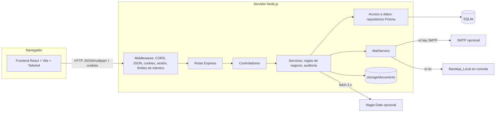
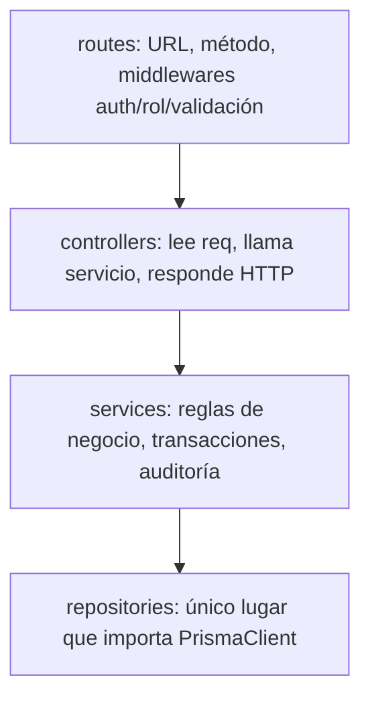
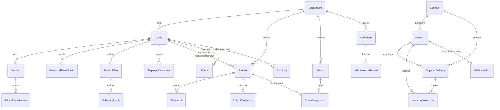
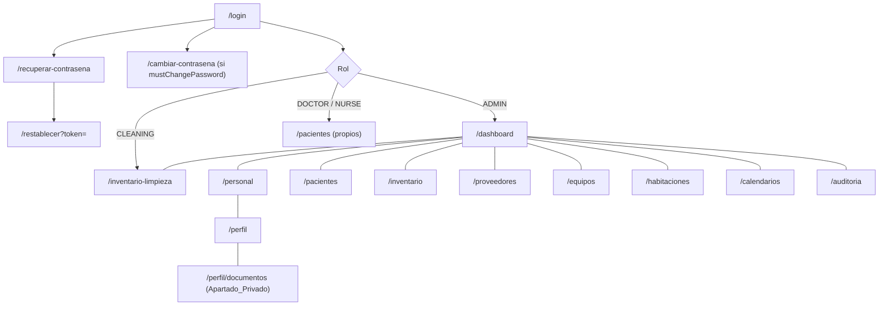

# Documento de Diseño

## Overview

El Sistema de Gestión y Administración Hospitalaria es una aplicación Full Stack local compuesta por dos proyectos independientes: un **frontend** (React + TypeScript + Vite + Tailwind CSS) y un **backend** (Node.js + Express + TypeScript) que persiste en **SQLite mediante Prisma ORM**. El frontend consume únicamente la API REST propia. La autenticación usa sesiones del lado del servidor con cookie `HttpOnly` + `SameSite=Strict`. El control de acceso por roles (RBAC) se aplica siempre en el backend; el frontend solo lo refleja en la interfaz.

Este documento cubre los Requisitos 1 a 28: autenticación y recuperación de contraseña (1, 17), RBAC (2, 21), validación (3), Dashboard (4), Personal y documentos (5, 18, 19), Pacientes (6, 20), Inventario médico, de limpieza, proveedores y movimientos (7, 22, 23, 24, 25), Equipos y mantenimiento (8, 26), Habitaciones (9, 27), Calendarios (10, 11, 28), auditoría (12), API (13), datos demo (14), interfaz (15) y organización (16).

### Decisiones de diseño y justificación

| Decisión | Justificación |
|---|---|
| Un único modelo `User` con los campos del Perfil (es el "Empleado" de los requisitos). Un Empleado es un `User` con rol distinto de `ADMIN`; el Administrador (Director) es un `User` con rol `ADMIN` que no cuenta como Empleado | Cada cuenta tiene exactamente un Rol (Req. 2.10) y todo Empleado tiene cuenta. Una tabla simplifica el código para un estudiante Junior (Req. 16) y respeta el conteo de 10 Empleados del Req. 5.1 y 14.1 |
| Sesiones en tabla `Session`: cookie con identificador aleatorio y la tabla guarda solo su hash SHA-256 | Permite invalidar en servidor (Req. 1.4, 1.5) y un volcado de la BD no revela tokens válidos (Req. 12.6) |
| `AdminAuthorization` con hash de un token aleatorio, entregado en una segunda cookie `aid` (`HttpOnly`, `SameSite=Strict`) y ligada a la `Session` | Cumple Req. 18.1, 18.2 y 18.10: sin contraseña maestra, sin guardar el token en claro, y se invalida sola al cerrar la Sesión (`onDelete: Cascade`) |
| `PasswordResetToken` guarda solo `sha256(token)` con `expiresAt` y `usedAt` | Req. 17.2 y 17.5: un solo uso, 30 minutos, sin token en BD ni en auditoría |
| Servicio de correo con interfaz `MailTransport` y dos implementaciones (SMTP y `LocalOutbox`) elegidas por variables de entorno | Req. 17.3, 17.4, 17.11 y 16.9: funciona sin internet ni servicios de pago |
| `role`, `status`, `type` como `String` validados con `zod`, no como `enum` de Prisma | Compatibilidad con SQLite y migraciones simples; los valores viven en `domain/constants.ts` |
| `availability` de Habitación y `lowStock`/`availability` de Producto **no se almacenan**: se calculan | Evita inconsistencias con Asignaciones y cantidades (Req. 7.3, 7.4, 9.9) |
| Los Movimientos (paciente e inventario), la auditoría y el historial de ocupación son solo de inserción; las rutas PUT, PATCH y DELETE responden 405 | Req. 12.7, 20.8, 25.6 |
| Las entregas de proveedor, Días_Inhábiles, feriados y cumpleaños **no se duplican como filas de `Event`**: los calendarios los generan como Eventos virtuales | Evita datos duplicados y desincronizados (Req. 10.5, 28.5 a 28.7) |
| Reglas de negocio puras en `domain/` (sin I/O) | Se prueban con propiedades sin base de datos |
| Esquemas `zod` duplicados en backend y frontend (no compartidos) | Mantiene `frontend` y `backend` totalmente independientes (Req. 16.1) |
| Auditoría escrita dentro de la misma `prisma.$transaction` que la operación | Reversión completa si falla el registro (Req. 12.1, 12.8, 12.9, 25.7) |
| Archivos PDF de documentos en `backend/storage/documents/` (fuera de cualquier carpeta pública) y entregados solo por ruta autenticada | Req. 19.6 |

### Investigación y fuentes que informan el diseño

- Prisma soporta SQLite con `$transaction` interactivas, `@@unique` compuestos e `onDelete` configurable; no soporta índices únicos parciales, por lo que "máximo una Asignación activa por Paciente" y "un solo mantenimiento en curso por Equipo" se aplican en el servicio dentro de una transacción ([Prisma: SQLite](https://www.prisma.io/docs/orm/overview/databases/sqlite)).
- Las cookies `HttpOnly` y `SameSite=Strict` son la mitigación estándar frente a robo de token por XSS y CSRF entre sitios ([OWASP Session Management](https://cheatsheetseries.owasp.org/cheatsheets/Session_Management_Cheat_Sheet.html)).
- Para restablecer contraseñas se recomiendan tokens aleatorios de un solo uso, vigencia corta, almacenados con hash y con respuesta idéntica exista o no la cuenta ([OWASP Forgot Password](https://cheatsheetseries.owasp.org/cheatsheets/Forgot_Password_Cheat_Sheet.html)).
- bcrypt es adecuado para hash de contraseñas ([OWASP Password Storage](https://cheatsheetseries.owasp.org/cheatsheets/Password_Storage_Cheat_Sheet.html)).
- Nager.Date ofrece `GET https://date.nager.at/api/v3/PublicHolidays/{año}/{códigoPaís}` sin autenticación ([Nager.Date](https://date.nager.at/Api)).
- Nodemailer permite enviar por SMTP o usar un transporte propio; `multer` procesa cargas multipart en Express.

*Contenido reformulado para cumplir con restricciones de licencia.*

## Architecture

### Vista general



### Capas del backend (Req. 16.2)



`routes` y `controllers` nunca importan `@prisma/client` ni `lib/prisma`. Los servicios usan `withTransaction` expuesto por la capa `repositories`.

### Estructura de carpetas

```
HospitalManager/
├── README.md                      # instalación, migración, semilla, ejecución, Bandeja_Local, cuentas demo (Req. 16.8)
├── .gitignore
├── backend/
│   ├── package.json
│   ├── tsconfig.json              # "strict": true
│   ├── .env.example               # SESSION_SECRET, DATABASE_URL, CORS_ORIGIN (requeridas); PORT, NODE_ENV, FRONTEND_URL,
│   │                              # NAGER_ENABLED, NAGER_COUNTRY, SMTP_HOST, SMTP_PORT, SMTP_USER, SMTP_PASSWORD, SMTP_FROM (opcionales)
│   ├── prisma/ (schema.prisma, migrations/, seed.ts)
│   ├── storage/documents/         # PDF ficticios, fuera de carpetas públicas (Req. 19.6)
│   ├── uploads/photos/            # fotos de Perfil cargadas
│   └── src/
│       ├── server.ts, app.ts
│       ├── config/env.ts          # valida variables; exit(1) si falta una requerida (Req. 16.6)
│       ├── lib/                   # prisma.ts, password.ts, tokens.ts, errors.ts, file-signature.ts
│       ├── middlewares/           # authenticate, authorize, requireAdminAuthorization, validate, upload, attemptLimiter,
│       │                          # requirePasswordChange, methodNotAllowed, errorHandler, notFound
│       ├── mail/                  # mail.service.ts, smtp.transport.ts, local-outbox.transport.ts, templates.ts
│       ├── domain/                # funciones PURAS (ver Interfaces internas)
│       ├── schemas/               # esquemas zod por recurso
│       ├── routes/, controllers/, services/, repositories/
│       └── types/
│   └── tests/                     # unit/, property/, integration/
└── frontend/
    ├── package.json, tsconfig.json (strict), vite.config.ts (proxy /api), tailwind.config.ts, .env.example (VITE_API_URL)
    └── src/
        ├── main.tsx, App.tsx
        ├── app/                   # router.tsx, ProtectedRoute.tsx, RoleGuard.tsx, navigation.ts
        ├── shared/
        │   ├── components/        # Layout, Sidebar, Topbar, DataTable, FormField, Modal, ConfirmDialog, StatusBadge,
        │   │                      # StatCard, ProgressBar, Spinner, Toast, Avatar, Icon, Tabs, SearchBox, AdminAuthDialog
        │   ├── hooks/             # useApi, useSort, usePagination, useAuth, useAdminAuth
        │   ├── lib/               # apiClient.ts, formatters.ts, messages.ts (textos en español), colors.ts, sortRows.ts
        │   └── types/
        ├── modules/               # un módulo funcional por área (Req. 16.3)
        │   ├── auth/              # LoginPage, ForgotPasswordPage, ResetPasswordPage, ChangePasswordPage
        │   ├── dashboard/
        │   ├── staff/             # lista, formulario, perfil, horario, documentos (admin) y Apartado_Privado
        │   ├── patients/          # pestañas por estado, detalle, historial, tratamientos
        │   ├── inventory/         # Módulo_Inventario (insumos y medicamentos), movimientos
        │   ├── cleaning/          # Módulo_Inventario_Limpieza (pantalla, API y menú propios, Req. 23.1)
        │   ├── suppliers/         # proveedores y entregas
        │   ├── equipment/         # equipos, mantenimiento, resumen
        │   ├── rooms/             # habitaciones, contadores, pestaña Historial
        │   ├── calendars/
        │   └── audit/
        └── styles/index.css
```

Cada módulo del frontend contiene `api.ts`, `schemas.ts` (zod), `components/`, `pages/` y `types.ts`. Los componentes usados por dos o más módulos viven en `shared/components`.

### Orden de construcción por módulos (Req. 16.10)

1. Base: backend (env, app, errores, Prisma, auth, RBAC, auditoría) y frontend (layout, login, rutas protegidas).
2. Recuperación de contraseña y servicio de correo.
3. Personal, Departamentos, horarios, fotos.
4. Autorización administrativa y documentos de empleados.
5. Pacientes, movimientos y tratamientos.
6. Habitaciones, asignaciones, liberaciones e historial de ocupación.
7. Inventario médico, proveedores, entregas y movimientos; inventario de limpieza.
8. Equipos médicos, mantenimiento y resumen.
9. Calendarios (turnos, días inhábiles, entregas) y feriados.
10. Dashboard y Bitácora.

Cada paso deja el sistema ejecutable sin los siguientes. La semilla se amplía por etapa.

## Components and Interfaces

### Convenciones globales de la API

- Prefijo `/api`. JSON UTF-8; multipart solo en carga de fotos y documentos; `application/pdf` en descarga de documentos (Req. 13.3). Códigos: 200 lectura/actualización, 201 creación, 204 eliminación sin contenido (Req. 13.2).
- **Formato de error** (Req. 13.4, 13.8):

```json
{ "code": "VALIDATION_ERROR", "message": "Los datos enviados no son válidos.",
  "errors": [ { "field": "name", "message": "El nombre es obligatorio." } ] }
```

Códigos: `VALIDATION_ERROR` (400), `UNAUTHENTICATED` (401), `FORBIDDEN` (403), `PASSWORD_CHANGE_REQUIRED` (403), `AUTORIZACION_ADMIN_REQUERIDA` (403, Req. 18.5), `NOT_FOUND` (404), `METHOD_NOT_ALLOWED` (405), `CONFLICT` (409), `TOO_MANY_REQUESTS` (429), `INTERNAL_ERROR` (500, mensaje genérico). `errors` solo aparece en 400.
- **Paginación** (Req. 13.6, 13.7) en Pacientes, Productos, Movimientos_de_Inventario, Entregas_de_Proveedor, Registros_de_Mantenimiento, Historial_de_Ocupación y auditoría: `?page=1&pageSize=10` (pageSize de 1 a 100, por defecto 10). Respuesta `{ "data": [...], "page": 1, "pageSize": 10, "total": 42 }`. Un `pageSize` fuera de rango o no entero produce 400.
- Las demás listas devuelven `{ "data": [...] }`.
- CORS: solo el origen `CORS_ORIGIN`, con `credentials: true`; otros orígenes no reciben cabeceras `Access-Control-*`; preflight en 500 ms o menos (Req. 13.9, 13.10).
- Leyenda de roles: **A** Administrador, **M** Médico, **E** Enfermero, **L** Personal_de_Limpieza, **Auth** cualquier usuario autenticado, **A+AA** Administrador con Autorización_Administrativa vigente.

### Endpoints REST

#### Autenticación y recuperación (`/api/auth`) — Req. 1, 17

| Método y ruta | Rol | Descripción | Respuestas |
|---|---|---|---|
| POST `/auth/login` | Público (límite 5 fallos/15 min por IP) | Crea Sesión y cookie `sid` | 200 usuario; 400; 401; 429 |
| POST `/auth/logout` | Auth | Invalida Sesión (y su Autorización_Administrativa) y borra cookies | 204 |
| GET `/auth/me` | Auth | Usuario, rol y `mustChangePassword` | 200; 401 |
| POST `/auth/change-password` | Auth (permitido con `mustChangePassword`) | `{currentPassword, newPassword}` (8 a 128). Conserva la Sesión actual, invalida las demás y las Autorizaciones_Administrativas, audita | 200; 400 |
| POST `/auth/forgot-password` | Público (límite 5/15 min por IP) | `{email}`. Siempre 200 con el mismo mensaje | 200; 429 |
| POST `/auth/reset-password` | Público | `{token, newPassword}` (8 a 128). Marca el token como usado, invalida todas las Sesiones | 200; 400 (token inválido/vencido/usado o contraseña fuera de rango) |

#### Autorización administrativa (`/api/admin-authorization`) — Req. 18

| Método y ruta | Rol | Descripción |
|---|---|---|
| POST `/admin-authorization` | A (otros 403) | `{password}` propia. Correcta: crea `AdminAuthorization` de 10 min ligada a la Sesión, fija cookie `aid`, responde `{expiresAt}` (201). Incorrecta: 401 y auditoría del rechazo. 5 incorrectas en 15 min: 429 incluso con la correcta |
| GET `/admin-authorization` | A | `{active, expiresAt}` |
| DELETE `/admin-authorization` | A | Revoca la autorización de la Sesión (204) |

#### Personal (`/api/staff`, `/api/departments`) — Req. 5

| Método y ruta | Rol | Descripción |
|---|---|---|
| GET `/staff?role=&departmentId=&shift=&search=` | A | Empleados (rol ≠ ADMIN), filtros con AND; búsqueda por nombre o ID interno sin distinguir mayúsculas (Req. 5.3) |
| POST `/staff` | A | Crea Empleado y cuenta con contraseña inicial única, `mustChangePassword=true`; la devuelve una sola vez (Req. 5.12) |
| GET `/staff/:id` | A (audita la consulta de otro Perfil, Req. 5.17), o el propio Empleado | 403 si es otro Empleado (Req. 5.9) |
| PUT `/staff/:id` | A | Edición completa; cambio de rol auditado |
| PATCH `/staff/me` | M, E, L | Solo `photoUrl` y `phone`. Cualquier otra clave en el cuerpo: 403 (Req. 5.7, 5.8). La contraseña se cambia en `/auth/change-password` |
| PUT `/staff/:id/schedule` | A, o el propio Empleado (`:id` = su id) | Reemplaza el Horario_de_Trabajo semanal; valida reglas del Req. 5.15, 400 si incumple |
| POST `/staff/:id/photo` | A, o el propio Empleado | multipart JPEG/PNG ≤ 2 MB con firma coincidente (Req. 5.13, 5.14) |
| DELETE `/staff/:id` | A | 409 si tiene Pacientes activos o es la propia cuenta; elimina también sus documentos y archivos (Req. 5.10, 5.11, 19.8) |
| GET `/departments` | Auth | Departamentos |

#### Documentos de empleados y Apartado_Privado — Req. 19

| Método y ruta | Rol | Descripción |
|---|---|---|
| GET `/me/documents` | M, E, L | Apartado_Privado: lista de sus propios documentos, con indicador `expired` |
| GET `/me/documents/:docId/file` | M, E, L | Descarga PDF propio; documento ajeno: 403 (Req. 19.4, 19.5) |
| GET `/staff/:id/documents` | A+AA | Lista documentos de un Empleado |
| POST `/staff/:id/documents` | A+AA | multipart: archivo PDF ≤ 5 MB, `type`, `title`, `issuedAt`, `expiresAt?` (201) |
| GET `/documents/:docId` | A+AA | Metadatos |
| GET `/documents/:docId/file` | A+AA | Descarga `application/pdf` |
| PUT `/documents/:docId` | A+AA | Reemplaza metadatos y/o archivo |
| DELETE `/documents/:docId` | A+AA | Elimina fila y archivo (204) |

Toda consulta, descarga, carga, reemplazo o eliminación audita antes de entregar datos; si la auditoría falla, 500 sin datos del documento (Req. 12.9, 19.7).

#### Pacientes (`/api/patients`) — Req. 6, 20, 21

| Método y ruta | Rol | Descripción |
|---|---|---|
| GET `/patients?status=&departmentId=&search=&page=&pageSize=` | A (todos); M y E (solo propios); L → 403 | Orden por `admissionDate` descendente (Req. 6.5, 6.6, 6.12) |
| GET `/patients/counts` | A, M, E | Número de Pacientes por estado dentro del alcance del actor (pestañas, Req. 20.9) |
| POST `/patients` | A | Crea Paciente y agrega movimiento `ingreso` en la misma transacción (Req. 20.1) |
| GET `/patients/:id` | A; M/E si es responsable | Si no, 403 |
| PUT `/patients/:id` | A | Datos generales, Departamento, responsables; no cambia `status` |
| PATCH `/patients/:id/status` | A | `{status: "dado de alta" \| "fallecido", deceasedAt?}`. Cierra Asignación activa con motivo, agrega movimiento, audita (Req. 6.13, 20.2, 20.3). Desde `fallecido`: 409 (Req. 20.5) |
| POST `/patients/:id/readmission` | A | `{admissionDate, departmentId, reason}`. Solo desde `dado de alta`; `fallecido` → 409 (Req. 20.4, 20.5) |
| PATCH `/patients/:id/medical-observation` | M responsable (y A) | `{text}` 0 a 1000; solo si `activo`, si no 409 (Req. 21.1, 21.7) |
| PATCH `/patients/:id/nursing-observation` | E responsable (y A) | Ídem para Observación_de_Enfermería (Req. 21.2) |
| GET `/patients/:id/movements` | A; M/E responsables | Historial_del_Paciente, más reciente primero (Req. 20.6, 20.7) |
| PUT, PATCH, DELETE `/patients/:id/movements...` | cualquiera | 405 (Req. 20.8) |
| GET `/patients/:id/treatments?type=&status=` | A; M/E responsables | Más reciente primero (Req. 20.10) |
| POST `/patients/:id/treatments` | A; M responsable | `{type, scheduledAt, description}`; máx. 100 por Paciente (Req. 6.11, 21.3) |
| PUT `/patients/:id/treatments/:tid` | A; M responsable | Edita datos |
| PATCH `/patients/:id/treatments/:tid/status` | A; M responsable (cancelar o realizar); E responsable (solo `realizado`) | `programado → realizado` registra `performedAt`; `programado → cancelado` (Req. 21.3, 21.4) |
| DELETE `/patients/:id` | A | |

#### Inventario médico (`/api/inventory`) — Req. 7, 22, 25

| Método y ruta | Rol | Descripción |
|---|---|---|
| GET `/inventory/products?category=&subcategory=&availability=&lowStock=&supplierId=&medicationType=&controlClass=&requiresPrescription=&controlled=&search=&page=&pageSize=` | A; M y E → 403; L → 403 | Solo `insumo médico` y `medicamento` (Req. 7.9, 22.6, 23.5) |
| POST `/inventory/products` | A | Valida subcategoría (Req. 22.1) y datos de medicamento (Req. 22.2 a 22.5); categoría `material de limpieza` → 400 (Req. 23.3). Crea Movimiento si cantidad > 0 |
| GET/PUT/DELETE `/inventory/products/:id` | A | Si la edición cambia la cantidad, registra Movimiento `ajuste` |
| POST `/inventory/products/:id/movements` | A | `{type: "entrada"\|"salida"\|"ajuste", quantity, reason}`; salida mayor a la existente → 409; sin motivo o > 200 → 400 (Req. 25.2 a 25.4, 7.7) |
| GET `/inventory/products/:id/movements` | A | Historial del Producto (Req. 25.8) |
| GET `/inventory/movements?productId=&category=&type=&userId=&from=&to=&page=&pageSize=` | A | Orden descendente; incluye ambos inventarios (Req. 25.5, 25.9) |
| PUT, PATCH, DELETE `/inventory/movements/:id` | cualquiera | 405 (Req. 25.6) |

#### Inventario de limpieza independiente (`/api/cleaning-inventory`) — Req. 23

| Método y ruta | Rol | Descripción |
|---|---|---|
| GET `/cleaning-inventory/products?availability=&lowStock=&supplierId=&search=&page=&pageSize=` | A; L (solo lectura); M y E → 403 | Solo `material de limpieza` (Req. 7.10, 23.2) |
| POST, PUT, DELETE `/cleaning-inventory/products[/:id]` | A (L → 403) | Otra categoría → 400 (Req. 23.3) |
| POST `/cleaning-inventory/products/:id/movements` | A | Mismo comportamiento que el inventario médico (Req. 23.4) |

#### Proveedores y entregas — Req. 7.12, 24

| Método y ruta | Rol | Descripción |
|---|---|---|
| GET/POST `/suppliers`, GET/PUT/DELETE `/suppliers/:id` | A | El detalle incluye Productos suministrados e historial de entregas con cantidades solicitada y recibida (Req. 24.8) |
| GET `/deliveries?supplierId=&productId=&status=&from=&to=&page=&pageSize=` | A (otros 403) | Orden por fecha programada descendente (Req. 24.7, 24.9) |
| POST `/deliveries` | A | `{supplierId, productId, quantityRequested 1..999999, scheduledDate}`; proveedor distinto al del Producto → 400 (Req. 24.1, 24.2) |
| GET/PUT `/deliveries/:id` | A | Edición solo en `programada`, si no 409 (Req. 24.5) |
| POST `/deliveries/:id/receive` | A | `{receivedDate ≤ hoy, quantityReceived 1..999999}`; en una transacción: estado `recibida`, Movimiento `entrada`, suma al Producto, auditoría; resultado > 999 999 → 409 (Req. 24.3, 24.4) |
| POST `/deliveries/:id/cancel` | A | `programada → cancelada`, sin tocar cantidad; audita (Req. 24.6) |

#### Equipos médicos y mantenimiento (`/api/equipment`, `/api/maintenance`) — Req. 8, 26

| Método y ruta | Rol | Descripción |
|---|---|---|
| GET `/equipment?departmentId=&category=&status=&search=` | A | Filtros AND (Req. 8.6); el frontend agrupa por Departamento (Req. 8.11) |
| GET `/equipment/summary` | A | Sumas de cantidad por categoría y Departamento, totales y total general (Req. 26.7) |
| POST `/equipment` | A | |
| GET/PUT/DELETE `/equipment/:id` | A | 404 si no existe (Req. 8.5) |
| PATCH `/equipment/:id/status` | A | Cambia `operationalStatus` (`disponible`, `en uso`, `en mantenimiento`, `fuera de servicio`); audita anterior y nuevo (Req. 8.7) |
| GET `/maintenance?equipmentId=&departmentId=&type=&open=&from=&to=&page=&pageSize=` | A | Orden por fecha de inicio descendente (Req. 26.6) |
| POST `/maintenance` | A | `{equipmentId, type, startDate ≤ hoy, description, technician}`; deja el Equipo `en mantenimiento`; ya hay uno en curso → 409 (Req. 26.1, 26.3) |
| POST `/maintenance/:id/close` | A | `{endDate ≥ startDate, resultingStatus: "disponible" \| "fuera de servicio"}` (Req. 26.2) |
| GET `/equipment/:id/maintenance` | A | Historial del Equipo (Req. 26.8) |

#### Habitaciones (`/api/rooms`, `/api/occupancy-history`) — Req. 9, 27

| Método y ruta | Rol | Descripción |
|---|---|---|
| GET `/rooms?departmentId=&availability=` | A | Incluye `availability` calculada y Pacientes con Asignación activa |
| GET `/rooms/counters` | A | Ocupadas y disponibles en total y por Departamento (Req. 27.1) |
| POST `/rooms`, PUT/DELETE `/rooms/:id` | A | Número único 1 a 9999; capacidad 1 a 10 |
| POST `/rooms/:id/assignments` | A | `{patientId}`; 409 si ocupada, si el Paciente ya tiene Asignación activa o no está `activo` (Req. 9.5 a 9.7) |
| POST `/rooms/:id/releases` | A | `{patientId, reason: "alta" \| "fallecimiento"}`; cierra Asignación, cambia estado del Paciente, agrega movimiento, audita; sin Asignación activa → 409; motivo inválido → 400 (Req. 9.4, 9.8, 9.13) |
| GET `/occupancy-history?departmentId=&roomId=&reason=&from=&to=&page=&pageSize=` | A | Asignaciones activas y cerradas, inicio descendente (Req. 27.4) |
| GET `/occupancy-history/summary?departmentId=&from=&to=` | A | Por Departamento: iniciadas, activas, liberaciones por alta y por fallecimiento (Req. 27.5) |

#### Calendarios, eventos, días inhábiles y feriados — Req. 10, 11, 28

| Método y ruta | Rol | Descripción |
|---|---|---|
| GET `/calendars/general?from=&to=` | Auth | Eventos `general`, Días_Inhábiles, feriados disponibles y entregas `programada`/`recibida` (Req. 28.5) |
| GET `/calendars/activities?from=&to=` | Auth | Eventos `actividad` y `entrega` y entregas `programada`/`recibida` solapadas (Req. 28.6). Las `cancelada` se excluyen siempre (Req. 28.7) |
| GET `/calendars/birthdays?year=` | Auth | Cumpleaños generados de `birthDate` de Empleados activos (Req. 10.5) |
| GET `/calendars/shifts?from=&to=` | A (todos los Empleados activos); M, E, L (solo el propio Turno y horario) | Calendario_de_Turnos (Req. 28.1, 28.2) |
| GET `/calendars/agenda?userId=&from=&to=` | Auth (`userId` solo A; si no, el propio) | Horario_de_Trabajo, Eventos personales y, para M/E, Tratamientos `programado` de sus Pacientes (Req. 10.6, 10.10) |
| POST/PUT/DELETE `/events` | A | Tipos `general`, `actividad`, `entrega` (Req. 10.3, 10.4) |
| POST/PUT/DELETE `/events/personal[/:id]` | Propietario de la agenda | Otra agenda: 403, incluso A (Req. 10.8) |
| GET `/non-working-days` | Auth | Lista |
| POST/PUT/DELETE `/non-working-days[/:id]` | A (otros 403) | Fecha duplicada → 409 (Req. 28.3, 28.4, 28.9) |
| GET `/holidays?year=` | Auth | `{available, data}`; año entero 1900 a 2100, si no 400 (Req. 11) |

#### Dashboard y auditoría — Req. 4, 12

| Método y ruta | Rol | Descripción |
|---|---|---|
| GET `/dashboard` | A (otros 403) | Seis estadísticas, indicadores adicionales, ocupación por Departamento y `upcoming` (Req. 4.1, 4.2, 4.9) |
| GET `/audit?userId=&action=&from=&to=&page=&pageSize=` | A | Más reciente primero |
| POST, PUT, PATCH, DELETE `/audit[/:id]` | cualquiera | 405 `METHOD_NOT_ALLOWED` (Req. 12.7) |

### Interfaces internas clave (solo firmas)

```ts
type Role = 'ADMIN' | 'DOCTOR' | 'NURSE' | 'CLEANING';
type Resource = 'staff' | 'ownProfile' | 'employeeDocuments' | 'ownDocuments' | 'patients' | 'patientObservations'
  | 'patientTreatments' | 'patientMovements' | 'inventory' | 'cleaningInventory' | 'suppliers' | 'deliveries'
  | 'inventoryMovements' | 'equipment' | 'maintenance' | 'rooms' | 'occupancy' | 'events' | 'nonWorkingDays'
  | 'shifts' | 'dashboard' | 'audit' | 'holidays' | 'adminAuthorization';
type Action = 'list' | 'read' | 'create' | 'update' | 'delete';

// domain/permissions.ts
function can(role: Role, resource: Resource, action: Action): boolean;
function canUpdatePatientField(p: { role: Role; isResponsible: boolean; patientStatus: PatientStatus;
  field: PatientField; treatmentTransition?: TreatmentTransition }): 'ALLOW' | 'FORBIDDEN' | 'CONFLICT';
function patientScope(actor: { id: number; role: Role }, patients: PatientLike[]): PatientLike[] | 'DENIED';

// domain/stock.ts
function isLowStock(quantity: number, minStock: number): boolean;
function availabilityOf(quantity: number): 'disponible' | 'agotado';
function applyMovement(current: number, m: { type: MovementType; quantity: number }):
  { ok: true; before: number; after: number } | { ok: false; error: 'INSUFFICIENT' | 'OVERFLOW' | 'INVALID' };
function inventoryScope(role: Role, products: ProductLike[], area: 'medical' | 'cleaning'): ProductLike[] | 'DENIED';

// domain/deliveries.ts
function receiveDelivery(d: DeliveryLike, productQty: number, received: number, receivedDate: Date, today: Date): Result;
function transitionDelivery(from: DeliveryStatus, to: 'recibida' | 'cancelada'): boolean;

// domain/patients.ts
function nextPatientStatus(from: PatientStatus, action: 'alta' | 'fallecimiento' | 'reingreso'): PatientStatus | 'CONFLICT';
function validDeathTime(deathAt: Date, lastAdmission: Date, now: Date): boolean;

// domain/rooms.ts
function roomAvailability(activeCount: number, capacity: number): 'disponible' | 'ocupada';
function occupancySummary(assignments: AssignmentLike[], range: DateRange): SummaryByDepartment[];

// domain/equipment.ts
function equipmentSummary(items: EquipmentLike[]): { cells: Cell[]; byCategory: Total[]; byDepartment: Total[]; total: number };
function canOpenMaintenance(openRecords: number): boolean;

// domain/schedule.ts
function validateDaySchedule(day: DaySchedule): FieldError[]; // vacío si es válido (Req. 5.15)

// domain/files.ts
function validateUpload(kind: 'photo' | 'pdf', f: { size: number; declaredType: string; head: Uint8Array }): FieldError[];
function validateDocumentDates(issuedAt: Date, expiresAt: Date | null, today: Date): FieldError[];

// domain/events.ts
function overlaps(ev: { start: Date; end: Date }, from: Date, to: Date): boolean;
function birthdayEvents(staff: StaffLike[], year: number): CalendarEvent[];
function upcomingWindow(items: CalendarEvent[], today: Date): CalendarEvent[];
function shiftCalendar(staff: StaffLike[], from: Date, to: Date): ShiftDay[];
function generalCalendar(input: CalendarInput): CalendarEvent[];  // excluye entregas canceladas
function eventColor(type: EventType): string;

// domain/dashboard.ts
function computeDashboardStats(data: DashboardData): { cards: Cards; indicators: Indicators; byDepartment: DeptOccupancy[] };

// domain/tokens.ts (reloj inyectado)
function isResetTokenUsable(t: { hash: string; expiresAt: Date; usedAt: Date | null }, presentedHash: string, now: Date): boolean;
function isAdminAuthorizationValid(a: { sessionId: number; expiresAt: Date; revokedAt: Date | null },
  currentSessionId: number, now: Date): boolean;
function isSessionExpired(lastActivityAt: Date, now: Date): boolean; // > 30 min

// domain/others.ts: parsePagination, parseYear, sanitizeAuditDetails, applyFilters, canEditOwnProfile, loadEnv, sortRows, contrastRatio

// middlewares/attemptLimiter.ts
class AttemptLimiter { // clave: IP (login, recuperación) o userId (autorización administrativa)
  registerFailure(key: string, now: Date): void; isBlocked(key: string, now: Date): boolean; reset(key: string): void; }

// mail/mail.service.ts
interface MailTransport { send(m: { to: string; subject: string; text: string }): Promise<void>; }
```

## Autenticación, recuperación y permisos

### Sesiones (Req. 1)

1. `POST /auth/login` aplica el límite por IP **antes** de comparar credenciales (429, Req. 1.10), compara con `bcrypt.compare` (contra un hash ficticio si el usuario no existe) y responde 401 con "Credenciales incorrectas." sin crear Sesión (Req. 1.2).
2. Si son válidas genera un token de 32 bytes, guarda `sha256(token)` en `Session` y envía la cookie `sid` (`HttpOnly`, `SameSite=Strict`, `Path=/`, `Secure` en producción), firmada con `SESSION_SECRET`.
3. `authenticate` busca la Sesión por hash; si no existe o `now - lastActivityAt > 30 min`, la borra y responde 401 (Req. 1.5, 1.6). Si es válida actualiza `lastActivityAt`.
4. `logout` borra la Sesión (la `AdminAuthorization` cae por cascada) y las cookies (Req. 1.4, 18.7).
5. Contraseñas con bcrypt (costo 10; 4 en pruebas), nunca registradas ni devueltas. Las contraseñas demo no están en código ni semilla en texto plano: la semilla las lee de `DEMO_*_PASSWORD` del entorno o las genera aleatoriamente y las imprime una sola vez en consola (Req. 1.7, 14.5).
6. Cambio de contraseña: verifica la actual y la longitud 8 a 128, actualiza el hash, borra las demás Sesiones del Usuario y sus Autorizaciones_Administrativas, audita (Req. 1.8, 1.9, 1.11, 18.7).
7. Contraseña inicial de un Empleado nuevo: aleatoria de 12 caracteres, única; `mustChangePassword=true`. Mientras sea verdadero, `requirePasswordChange` responde 403 `PASSWORD_CHANGE_REQUIRED` salvo en `/auth/me`, `/auth/logout` y `/auth/change-password` (Req. 5.12).

### Recuperación de contraseña por correo (Req. 17)

```mermaid
sequenceDiagram
    participant V as Visitante
    participant API as Backend
    participant DB as Base_de_Datos
    participant M as MailService
    V->>API: POST /auth/forgot-password {email}
    API->>API: límite 5/15 min por IP (429)
    API->>DB: busca cuenta activa por email
    alt existe
        API->>DB: invalida tokens previos; guarda sha256(token), expiresAt=+30 min
        API->>M: enlace FRONTEND_URL/restablecer?token=...
        API->>DB: auditoría (sin token)
    end
    API-->>V: 200 mismo mensaje exista o no la cuenta
    V->>API: POST /auth/reset-password {token, newPassword}
    API->>DB: busca por sha256(token); valida vigente y no usado
    API->>DB: actualiza hash, usedAt, mustChangePassword=false, borra Sesiones, audita
    API-->>V: 200 (o 400 inválido/vencido; 400 contraseña fuera de rango sin consumir el token)
```

**MailService** (Req. 17.3, 17.4, 17.11): `createMailService(env)` devuelve `SmtpTransport` (nodemailer) si existen `SMTP_HOST`, `SMTP_PORT`, `SMTP_USER`, `SMTP_PASSWORD` y `SMTP_FROM`; si no y `NODE_ENV !== 'production'`, `LocalOutboxTransport`, que escribe en la consola del Backend el destinatario, asunto y enlace (la **Bandeja_Local**) y lo conserva en memoria. En producción sin SMTP no se envía y se registra una advertencia. El token solo aparece en el enlace del correo, nunca en la auditoría ni en logs de la aplicación fuera de la Bandeja_Local. El README explica cómo ver la Bandeja_Local (Req. 16.8).

### Flujo de Autorización_Administrativa (Req. 18, 19)

No existe contraseña maestra ni credencial compartida: se reutiliza la contraseña propia del Administrador.

```mermaid
sequenceDiagram
    participant F as Frontend
    participant API as Backend
    participant DB as Base_de_Datos
    F->>API: GET /staff/7/documents (cookie sid)
    API->>API: authenticate, rol A, requireAdminAuthorization
    API-->>F: 403 AUTORIZACION_ADMIN_REQUERIDA
    F->>F: AdminAuthDialog pide la contraseña del Administrador
    F->>API: POST /admin-authorization {password}
    API->>API: límite por userId (5/15 min, 429)
    API->>DB: bcrypt.compare con hash propio
    alt correcta
        API->>DB: guarda sha256(token), sessionId, expiresAt=+10 min; auditoría OTORGADA
        API-->>F: 201 {expiresAt} + cookie aid (HttpOnly, SameSite=Strict)
        F->>API: repite GET /staff/7/documents
        API->>API: hash(aid) coincide, misma Sesión, no revocada, now < expiresAt
        API->>DB: auditoría DOCUMENT_LIST, luego entrega
        API-->>F: 200
    else incorrecta
        API->>DB: auditoría RECHAZADA (sin contraseña)
        API-->>F: 401
    end
```

- `requireAdminAuthorization` se aplica solo a las rutas de documentos de otros Empleados. Responde 403 `AUTORIZACION_ADMIN_REQUERIDA` si falta la cookie, no coincide el hash, pertenece a otra Sesión, fue revocada o venció, sin cerrar la Sesión (Req. 18.5, 18.8).
- Se invalida al cerrar o expirar la Sesión, al cambiar contraseña o por `DELETE /admin-authorization` (Req. 18.7).
- Solo se almacena el hash; no aparece en consola ni en auditoría (Req. 18.2).
- Un rol distinto de Administrador recibe 403 (Req. 18.6). El cliente `apiClient` detecta el código, abre `AdminAuthDialog` y repite la solicitud original tras el éxito (Req. 18.9).

### Matriz de permisos (RBAC)

Fuente única en `domain/permissions.ts`; `authorize(resource, action)` la consulta antes del controlador (Req. 2.1). Los servicios añaden reglas de **alcance** (propiedad y responsable).

| Recurso | ADMIN (Director) | DOCTOR | NURSE | CLEANING |
|---|---|---|---|---|
| Personal (otros Empleados) | CRUD | Sin acceso | Sin acceso | Sin acceso |
| Perfil propio | Leer y editar | Leer; editar foto, teléfono, contraseña, horario | Ídem | Ídem |
| Documentos de empleados | CRUD con Autorización_Administrativa vigente | Solo propios, lectura y descarga | Ídem | Ídem |
| Pacientes (lista y detalle) | CRUD | Solo propios (médico responsable) | Solo propios (enfermero responsable) | 403 |
| Observación_Médica | Actualizar | Actualizar si es responsable y `activo` | Solo lectura | 403 |
| Observación_de_Enfermería | Actualizar | Solo lectura | Actualizar si es responsable y `activo` | 403 |
| Tratamientos_Programados | CRUD | Crear, editar, cancelar y marcar realizado (propios, `activo`) | Solo marcar `realizado` (propios, `activo`) | 403 |
| Estado, datos generales, Departamento, responsables, fecha de ingreso | Gestionar | 403 | 403 | 403 |
| Historial_del_Paciente | Leer | Leer si es responsable | Leer si es responsable | 403 |
| Inventario médico y medicamentos | CRUD | 403 | 403 | 403 |
| Inventario de limpieza | CRUD | 403 | 403 | Solo lectura |
| Proveedores y entregas | CRUD | 403 | 403 | 403 |
| Movimientos de inventario | Crear y leer | 403 | 403 | 403 |
| Equipos, resumen y mantenimiento | CRUD | 403 | 403 | 403 |
| Habitaciones, asignaciones, contadores e historial de ocupación | CRUD y operar | 403 | 403 | 403 |
| Eventos general, actividad y entrega | CRUD | Leer | Leer | Leer |
| Agenda individual | Consultar cualquiera; editar solo la propia | Propia (CRUD de sus Eventos personales) | Propia | Propia |
| Días_Inhábiles | CRUD | Leer | Leer | Leer |
| Calendario_de_Turnos | Todos los Empleados | Solo el propio | Solo el propio | Solo el propio |
| Feriados | Leer | Leer | Leer | Leer |
| Dashboard y Bitácora | Leer | 403 | 403 | 403 |
| Autorización_Administrativa | Solicitar | 403 | 403 | 403 |

Orden de verificación: (1) sesión → 401; (2) cambio de contraseña pendiente → 403; (3) `can(rol, recurso, acción)` → 403; (4) Autorización_Administrativa cuando aplica → 403 `AUTORIZACION_ADMIN_REQUERIDA`; (5) alcance por propiedad/responsable → 403; (6) validación → 400; (7) reglas de negocio → 404, 409 (incluye paciente no `activo` para M/E, Req. 21.7). Las respuestas 403 nunca incluyen datos del recurso.

Cada cuenta tiene exactamente un rol: la columna `role` es única por fila y los endpoints rechazan arreglos de roles (Req. 2.10).

### Reflejo en el frontend

- `AuthContext` guarda el usuario de `/auth/me`. `navigation.ts` define para cada ítem los roles permitidos, derivados de la misma matriz; `Sidebar` filtra por rol (Req. 2.8, 15.3).
- `RoleGuard` redirige las rutas no permitidas a la página de inicio del rol en menos de 1 s con aviso "Acceso denegado" (Req. 2.9).
- Inicio por rol: ADMIN `/dashboard`; DOCTOR y NURSE `/pacientes`; CLEANING `/inventario-limpieza`.
- Los controles de edición del detalle del Paciente se muestran solo si el rol puede ejecutarlos (Req. 21.8).

## Data Models

### Diagrama entidad-relación



### Esquema Prisma (descripción por tabla)

`Int` autoincremental como PK; `internalId` es el ID interno de negocio. Fechas `DateTime` en UTC. El esquema se entrega en `backend/prisma/schema.prisma` en implementación. Las tablas marcan lo **nuevo** (N) o **modificado** (M) respecto al diseño previo.

#### Department
`id`, `name` (único, 1 a 100). Valores iniciales: Urgencias, Cardiología, Pediatría, Cirugía, Radiología, Medicina Interna.

#### User (cuenta + Perfil del Empleado) (M)
| Campo | Tipo | Restricciones |
|---|---|---|
| id | Int | PK |
| internalId | String | único, 1 a 30 |
| email | String | único, dominio ficticio reservado |
| passwordHash | String | bcrypt |
| role | String | `ADMIN`, `DOCTOR`, `NURSE`, `CLEANING` |
| mustChangePassword | Boolean | por defecto false |
| active | Boolean | por defecto true |
| name | String | 1 a 100 |
| photoUrl | String? | foto ilustrativa por defecto si es nula (Req. 5.13) |
| position | String | cargo, 1 a 100 |
| description (N) | String | 0 a 500 |
| specialty | String | 1 a 100 |
| departmentId | Int | FK → Department, `Restrict` |
| yearsExperience | Int | 0 a 60 |
| shift | String | `matutino` o `vespertino` (M) |
| phone | String | 1 a 30 |
| birthDate | DateTime? | cumpleaños |
| createdAt, updatedAt | DateTime | |

Índices: `role`, `departmentId`, `shift`.

#### ScheduleSlot (Horario_de_Trabajo; antes `WorkScheduleSlot`) (M)
| Campo | Tipo | Restricciones |
|---|---|---|
| id | Int | PK |
| userId | Int | FK → User, `Cascade` |
| dayOfWeek | Int | 0 a 6 |
| startTime, endTime | String | `HH:mm`, `endTime > startTime` |
| mealStart (N), mealEnd (N) | String? | periodo de comida dentro de entrada y salida |

`@@unique([userId, dayOfWeek])`.

#### ScheduleBreak (Descanso) (N)
`id`, `slotId` (FK → ScheduleSlot, `Cascade`), `startTime`, `endTime` (`HH:mm`). Máximo 3 por día; dentro del intervalo del día; sin solape entre sí ni con la comida (validado por `validateDaySchedule`).

#### Session (M)
`id`, `tokenHash` (único), `userId` (FK `Cascade`), `createdAt`, `lastActivityAt`.

#### PasswordResetToken (N)
| Campo | Tipo | Restricciones |
|---|---|---|
| id | Int | PK |
| userId | Int | FK → User, `Cascade` |
| tokenHash | String | único, SHA-256 hex del token de ≥ 32 bytes |
| expiresAt | DateTime | creación + 30 min |
| usedAt | DateTime? | nulo = no usado |
| createdAt | DateTime | |

Índice `(userId, usedAt)`. Al emitir uno nuevo se invalidan los previos de la cuenta.

#### AdminAuthorization (N)
| Campo | Tipo | Restricciones |
|---|---|---|
| id | Int | PK |
| sessionId | Int | FK → Session, `Cascade`, único (una por Sesión) |
| userId | Int | FK → User, `Cascade` |
| tokenHash | String | único, SHA-256 |
| expiresAt | DateTime | otorgamiento + 10 min |
| revokedAt | DateTime? | |
| createdAt | DateTime | |

#### EmployeeDocument (N)
| Campo | Tipo | Restricciones |
|---|---|---|
| id | Int | PK |
| userId | Int | FK → User (propietario), `Cascade` |
| type | String | `contratación` o `acreditación` |
| title | String | 1 a 150 |
| issuedAt | DateTime | no posterior a hoy |
| expiresAt | DateTime? | no anterior a `issuedAt` |
| filePath | String | ruta relativa en `storage/documents` |
| fileSize | Int | ≤ 5 242 880 |
| createdAt, updatedAt | DateTime | |

El indicador `expired` se calcula (`expiresAt < hoy`). Al eliminar un Empleado, el servicio borra también los archivos.

#### Patient (M)
| Campo | Tipo | Restricciones |
|---|---|---|
| id | Int | PK |
| internalId | String | único, 1 a 30 |
| firstName, lastName | String | 1 a 100 |
| birthDate | DateTime | |
| sex | String | `F`, `M`, `X` |
| phone | String? | |
| admissionDate | DateTime | fecha de ingreso más reciente; no posterior a hoy |
| reason | String | 1 a 500 |
| status | String | `activo`, `dado de alta`, `fallecido` |
| deceasedAt (N) | DateTime? | solo si `fallecido`; ≤ ahora y ≥ último ingreso |
| departmentId | Int | FK `Restrict` |
| doctorId, nurseId | Int | FK → User `Restrict` (rol validado en servicio) |
| medicalObservation (N) | String | 0 a 1000 |
| medicalObservationAt, medicalObservationById (N) | DateTime?, Int? | quién y cuándo |
| nursingObservation (N) | String | 0 a 1000 |
| nursingObservationAt, nursingObservationById (N) | DateTime?, Int? | |
| createdAt, updatedAt | DateTime | |

Índices: `status`, `departmentId`, `doctorId`, `nurseId`, `admissionDate`.

#### PatientMovement (Registro_de_Movimiento_del_Paciente) (N)
`id`, `patientId` (FK `Cascade`), `type` (`ingreso`, `alta`, `fallecimiento`), `occurredAt`, `departmentId` (FK `Restrict`), `userId` (FK `Restrict`), `note` (0 a 500). Solo inserción; sin rutas de edición ni borrado (405).

#### Treatment (Tratamiento_Programado) (M)
| Campo | Tipo | Restricciones |
|---|---|---|
| id | Int | PK |
| patientId | Int | FK `Cascade` |
| type (N) | String | `tratamiento` o `cirugía` |
| status (N) | String | `programado`, `realizado`, `cancelado` |
| scheduledAt | DateTime | |
| performedAt (N) | DateTime? | al marcar `realizado` |
| description | String | 1 a 500 |
| createdById (N) | Int | FK → User `Restrict` |

Máximo 100 por Paciente (servicio). Solo los `programado` aparecen en calendarios (Req. 6.11).

#### Room (M)
`id`, `number` (único, 1 a 9999), `departmentId` (FK `Restrict`), `capacity` (1 a 10). Sin columna de disponibilidad.

#### RoomAssignment (M)
`id`, `roomId` (FK `Restrict`), `patientId` (FK `Restrict`), `startedAt`, `endedAt?`, `releaseReason?` (N: `alta` o `fallecimiento`; nulo mientras esté activa, Req. 27.3). Índices `(patientId, endedAt)`, `(roomId, endedAt)`. Invariantes en servicio: una activa por Paciente; activas ≤ capacidad. La Habitación debe ser del mismo Departamento que el Paciente en la semilla (Req. 14.8).

#### Supplier
`id`, `name` (1 a 100), `contact`.

#### Product (M)
`id`, `name` (1 a 100), `category` (`insumo médico`, `medicamento`, `material de limpieza`), `classification` (1 a 50; Subcategoría_de_Insumo para insumos: jeringa, sonda, catéter, suero, instrumental, material médico), `quantity` (0 a 999 999), `minStock` (0 a 999 999), `supplierId` (FK `Restrict`), `createdAt`, `updatedAt`. `lowStock` y `availability` son derivados.

#### MedicationInfo (M)
| Campo | Tipo | Restricciones |
|---|---|---|
| productId | Int | PK y FK `Cascade` |
| type | String | `genérico` o `de patente` |
| activeIngredient (N) | String | 1 a 100 |
| tradeName (N) | String? | 1 a 100, obligatorio si `de patente` |
| controlClass | String | `venta libre`, `receta simple`, `receta retenida`, `controlado`, `uso hospitalario` |
| requiresPrescription | Boolean | coherente con `controlClass` (Req. 22.4) |

`controlled` (Medicamento_Controlado) se deriva de `controlClass = "controlado"`.

#### SupplierDelivery (Entrega_de_Proveedor) (N)
| Campo | Tipo | Restricciones |
|---|---|---|
| id | Int | PK |
| supplierId | Int | FK `Restrict` |
| productId | Int | FK `Restrict`; el Proveedor debe ser el del Producto |
| quantityRequested | Int | 1 a 999 999 |
| scheduledDate | DateTime | |
| status | String | `programada`, `recibida`, `cancelada` |
| receivedDate | DateTime? | ≤ hoy |
| quantityReceived | Int? | 1 a 999 999 |

Índices: `status`, `scheduledDate`, `supplierId`, `productId`.

#### InventoryMovement (N)
`id`, `productId` (FK `Restrict`), `type` (`entrada`, `salida`, `ajuste`), `quantityBefore`, `quantityAfter`, `reason` (1 a 200), `userId` (FK `Restrict`), `deliveryId?` (FK → SupplierDelivery), `createdAt` (UTC). Solo inserción (405 en edición y borrado). Índices `(productId, createdAt)`, `type`, `userId`.

#### Equipment (M)
`id`, `name` (1 a 100), `category` (1 a 50), `departmentId` (FK `Restrict`), `quantity` (1 a 9999), `location` (1 a 100), `operationalStatus` (`disponible`, `en uso`, `en mantenimiento`, `fuera de servicio`), `maintenanceRequired` (Boolean), `createdAt`, `updatedAt`.

#### MaintenanceRecord (N)
`id`, `equipmentId` (FK `Restrict`), `type` (`preventivo`, `correctivo`, `reparación`), `startDate` (≤ hoy), `endDate?` (≥ `startDate`), `description` (1 a 500), `technician` (1 a 100), `resultingStatus?` (`disponible` o `fuera de servicio`, al cerrar). Nulo `endDate` = en curso. Índices `(equipmentId, endDate)`, `startDate`.

#### Event (M)
`id`, `title` (1 a 150), `description?` (≤ 500), `type` (`general`, `actividad`, `entrega`, `agenda individual`), `startAt`, `endAt` (`endAt >= startAt`), `ownerId?` (FK `Cascade`; obligatorio si `agenda individual`), `createdById` (FK `Restrict`). Cumpleaños, feriados, Días_Inhábiles y entregas de proveedor son virtuales. Color derivado del tipo.

#### NonWorkingDay (N)
`id`, `date` (único; duplicado → 409), `title` (1 a 150), `description` (0 a 500), `createdById` (FK `Restrict`).

#### AuditLog (M)
| Campo | Tipo | Restricciones |
|---|---|---|
| id | Int | PK |
| userId | Int? | FK → User `SetNull`; **nulo** si la acción no corresponde a una cuenta identificable (p. ej. inicio de sesión fallido con correo desconocido, Req. 12.1) |
| action | String | ver lista |
| entityType | String | `User`, `Session`, `Employee`, `EmployeeDocument`, `Patient`, `Room`, `Product`, `SupplierDelivery`, `Equipment`, `MaintenanceRecord` |
| entityId | Int? | |
| details | String | JSON saneado |
| createdAt | DateTime | UTC, precisión de segundos |

Índices: `createdAt`, `userId`, `action`. Sin rutas de actualización ni borrado.

### Bitácora de auditoría (Req. 12)

**Acciones sensibles registradas** (únicamente estas, Req. 12.2): `LOGIN_SUCCESS`, `LOGIN_FAILURE`, `PASSWORD_RESET_REQUEST`, `PASSWORD_RESET_COMPLETE`, `PASSWORD_CHANGE`, `ADMIN_AUTH_GRANTED`, `ADMIN_AUTH_REJECTED`, `DOCUMENT_READ`, `DOCUMENT_DOWNLOAD`, `DOCUMENT_UPLOAD`, `DOCUMENT_REPLACE`, `DOCUMENT_DELETE`, `PROFILE_DETAIL_READ`, `EMPLOYEE_CREATE`, `EMPLOYEE_DELETE`, `EMPLOYEE_UPDATE`, `ROLE_CHANGE`, `PATIENT_STATUS_CHANGE`, `PATIENT_ADMISSION`, `PATIENT_READMISSION`, `ROOM_ASSIGN`, `ROOM_RELEASE`, `INVENTORY_MOVEMENT`, `DELIVERY_RECEIVE`, `DELIVERY_CANCEL`, `EQUIPMENT_STATUS_CHANGE`, `MAINTENANCE_OPEN`, `MAINTENANCE_CLOSE`.

- Cada registro se escribe en la misma `$transaction` que la operación (Req. 12.1). Si falla, se revierte todo y se responde 500 con "La operación no se completó." (Req. 12.8). Para documentos, la auditoría se escribe antes de enviar el archivo; si falla, 500 sin datos (Req. 12.9).
- `sanitizeAuditDetails` elimina contraseñas, hashes, Tokens_de_Recuperación, Autorizaciones_Administrativas y tokens de sesión (Req. 12.6, 18.2).
- `GET /audit` ofrece filtros por usuario, acción y rango inclusivo; el frontend muestra "No hay resultados" si no hay coincidencias (Req. 12.3, 12.4).

### Integridad referencial (Req. 14.7)

- Claves foráneas con `Restrict`, salvo dependientes puros (`Session`, `AdminAuthorization`, `PasswordResetToken`, `ScheduleSlot`, `ScheduleBreak`, `EmployeeDocument`, `Treatment`, `PatientMovement`, `MedicationInfo`, `Event` personal) con `Cascade`, y `AuditLog.userId` con `SetNull`.
- Eliminar Departamento, Proveedor, Habitación, Producto, Equipo o Empleado con dependientes produce 409; los errores Prisma `P2002` y `P2003` se traducen a 409 en español.

### Semilla (Req. 14)

`prisma/seed.ts` corre en una sola `$transaction` con `upsert` por claves naturales, para ser idempotente (segunda ejecución sin duplicados, código 0) y revertir ante cualquier fallo mostrando la causa (Req. 14.4, 14.9). Carga: 6 Departamentos; 1 o más cuentas Administrador (Director) y 10 Empleados (≥ 2 DOCTOR, ≥ 2 NURSE, ≥ 2 CLEANING, ≥ 4 por Turno); 20 Documentos_de_Empleado (contratación y acreditación por Empleado, PDF ficticios); 12 Pacientes (7 `activo`, 3 `dado de alta`, 2 `fallecido`) con 17 movimientos (12 ingresos, 3 altas, 2 fallecimientos) y ≥ 12 Tratamientos (≥ 2 cirugías, ≥ 2 realizados); 20 Habitaciones (≥ 1 por Departamento) con 5 Asignaciones cerradas (3 `alta`, 2 `fallecimiento`) y las activas en Habitaciones del mismo Departamento; 20 Productos (≥ 5 por categoría); Proveedores; 8 Entregas (4 recibidas, 3 programadas, 1 cancelada); 24 Movimientos (un ajuste inicial por Producto y una entrada por entrega recibida); 12 Equipos (≥ 1 por Departamento y por Estado_Operativo) con 6 Registros_de_Mantenimiento (4 cerrados y 2 en curso); 3 Días_Inhábiles. Todos los datos son ficticios (correos con dominio reservado `example.com`, sin identificadores oficiales reales). Cada cuenta demo tiene contraseña propia distinta, tomada de variables de entorno o generada y documentada solo como credencial de demostración (Req. 14.3, 14.5).

## Diseño visual y navegación

### Lineamientos (Req. 15)

- Interfaz 100 % en español, con textos centralizados en `shared/lib/messages.ts` (Req. 15.1).
- Fondo blanco; color predominante azul (`blue-700` para botones, `blue-800` para encabezados, `blue-50` para elemento activo). Texto `slate-900` sobre blanco; contraste ≥ 4.5:1 (Req. 15.2, 15.14).
- Íconos médicos con `lucide-react` (`Stethoscope`, `HeartPulse`, `Users`, `BedDouble`, `Pill`, `Syringe`, `SprayCan`, `Truck`, `CalendarDays`, `ShieldCheck`) en el menú y en cada `StatCard` (Req. 15.6).
- Fotos ilustrativas ficticias locales (`frontend/public/avatars`) en Perfiles y en el login (Req. 15.8).
- Transiciones de 150 a 250 ms en menús, diálogos y cambio de página (≤ 300 ms, Req. 15.9).
- Un único conjunto de componentes (tarjetas, tablas, formularios, botones, insignias) con la misma tipografía y espaciado (Req. 15.16).

### Mapa de rutas



| Ruta | Pantalla | Roles |
|---|---|---|
| `/login` | Inicio de sesión con foto ilustrativa y enlace "¿Olvidaste tu contraseña?" (Req. 17.10) | Público |
| `/recuperar-contrasena`, `/restablecer` | Solicitar enlace y fijar nueva contraseña | Público |
| `/cambiar-contrasena` | Cambio obligatorio o voluntario | Auth |
| `/dashboard` | Seis `StatCard`, indicadores adicionales, barras de ocupación por Departamento con valor numérico y lista de próximos 7 días | A |
| `/personal`, `/personal/nuevo`, `/personal/:id` | Tabla con búsqueda y filtros (rol, Departamento, Turno), formulario, detalle con editor de horario y documentos (con `AdminAuthDialog`) | A |
| `/perfil` | Perfil propio: foto circular, nombre, cargo, Departamento, Turno y descripción (una columna en < 768 px, Req. 15.17); edita foto, teléfono, horario y contraseña | A, M, E, L |
| `/perfil/documentos` | Apartado_Privado: lista con tipo, fechas e insignia "Vencido" (Req. 19.9) | M, E, L |
| `/pacientes`, `/pacientes/nuevo`, `/pacientes/:id` | Pestañas "Activos", "Dados de alta", "Fallecidos" con contadores; detalle con historial, tratamientos (filtros por tipo y estado) y controles según rol | A; M y E (solo propios) |
| `/inventario` | Insumos y medicamentos con filtros (Req. 7.9, 22.6), insignia "Controlado", aviso de datos ficticios, detalle con movimientos | A |
| `/inventario-limpieza` | Módulo_Inventario_Limpieza independiente | A (gestión); L (lectura) |
| `/proveedores` | Proveedores, detalle con Productos y entregas, registrar recepción o cancelación | A |
| `/equipos` | Equipos agrupados por Departamento con conteo, pestañas "Mantenimiento" y "Resumen" | A |
| `/habitaciones` | Contadores, tarjetas por Departamento, diálogos de asignar y liberar (motivo), pestaña "Historial" con filtro por Departamento y resumen (Req. 27.7) | A |
| `/calendarios` | Pestañas: General, Actividades y entregas, Cumpleaños, Turnos, Mi agenda; leyenda de colores; vista mes y semana | Auth (Turnos: A todos, otros solo el propio; A elige Empleado en agenda) |
| `/auditoria` | Tabla paginada con filtros de usuario, acción y fechas | A |

### Layout y responsividad (Req. 15.4, 15.10, 4.8)

- **Computadora (≥ 1280 px)**: `Sidebar` fijo de 256 px y contenido a ancho completo; dashboard `xl:grid-cols-3`.
- **Tablet (768 a 1279 px)**: `Sidebar` fijo compacto; dashboard `md:grid-cols-2`; tablas con `overflow-x-auto` interno.
- **Celular (320 a 767 px)**: `Sidebar` oculto y abierto como panel desplegable con botón de menú; dashboard `grid-cols-1`; formularios y Perfiles en una columna; tablas dentro de contenedor con desplazamiento propio, sin desplazamiento horizontal de la página.

### Componentes compartidos

| Componente | Responsabilidad |
|---|---|
| `DataTable<T>` | Orden ascendente/descendente por cualquier columna, paginación (Req. 15.5) |
| `SearchBox` y barra de filtros | Búsqueda por texto en cada listado principal (Req. 15.15) |
| `FormField` | Etiqueta visible, entrada y error junto al campo |
| `StatusBadge` | Color + texto para estado del Paciente, Estado_Operativo, disponibilidad de Habitación, Stock_Bajo, estado de entrega y de tratamiento (Req. 15.7) |
| `StatCard`, `ProgressBar` | Estadísticas con ícono; porcentaje con barra y texto (Req. 4.10) |
| `ConfirmDialog` | "Confirmar" / "Cancelar" antes de cualquier DELETE (Req. 15.13) |
| `AdminAuthDialog` | Solicita la contraseña del Administrador y repite la solicitud original (Req. 18.9) |
| `Spinner`, botón con `disabled` en carga | Req. 15.11 |
| `Toast` / `ErrorBanner` | Errores de API en español, sin borrar el formulario (Req. 15.12) |
| `CalendarView` | Mes y semana, leyenda de colores (Req. 10.2, 10.11) |
| `Avatar` | Foto circular con imagen por defecto |

Colores de estado: `activo`/`disponible`/`recibida`/`realizado` verde; `dado de alta`/`programado`/`programada` azul; `fallecido`/`fuera de servicio`/`agotado`/`Stock bajo`/`cancelado`/`cancelada` rojo; `en mantenimiento`/`en uso` ámbar; `ocupada` naranja; "Controlado" púrpura. Siempre con texto visible.

Colores de Tipo_de_Evento (derivados, no almacenados): general azul, actividad verde, entrega naranja, cumpleaños rosa, agenda individual violeta, día inhábil gris, feriado rojo oscuro. Siete colores distintos (Req. 10.2, 11.2, 28.8).

### Validación y manejo de formularios en el frontend

- Cada formulario usa un esquema `zod` del módulo; valida al enviar con errores por campo en ≤ 500 ms, sin enviar si hay errores y conservando valores. Se rechazan cadenas solo con espacios (Req. 3.1, 3.2).
- Respuestas 400 con `errors[]` se asignan a cada campo; 409 se asigna al campo `internalId` cuando corresponde (Req. 3.5, 3.8).
- `apiClient` usa `fetch` con `credentials: 'include'`, tiempo máximo de 10 s en el dashboard con mensaje de error sin valores parciales (Req. 4.6), y errores tipados `ApiError{ status, code, message, errors }`. Un 401 lleva a `/login`; `AUTORIZACION_ADMIN_REQUERIDA` abre `AdminAuthDialog`.

## Correctness Properties

*Una propiedad es una característica o comportamiento que debe cumplirse en todas las ejecuciones válidas de un sistema; es decir, una declaración formal de lo que el sistema debe hacer. Las propiedades sirven de puente entre las especificaciones legibles por personas y las garantías de correctitud verificables por máquina.*

**Aplicabilidad:** las propiedades se limitan a la lógica pura de `domain/`, los esquemas `zod` y utilidades del frontend. CRUD sobre SQLite, interfaz, correo, auditoría transaccional, semilla y Nager.Date se cubren con pruebas de ejemplo e integración.

**Reflexión de propiedades:** se consolidaron propiedades redundantes: todas las validaciones de rango, longitud y vacío (Req. 3, 6.3, 6.4, 7.8, 8.9, 9.2, 22, 24.1, 26.1) en la Property 5; todos los filtros con AND (incluidos los de los Requisitos 22.6, 24.7, 25.5, 26.6 y 27.4) en la Property 6; los 403 por rol en la Property 4; los límites de intentos de login, recuperación y autorización administrativa en la Property 26; y el conteo de equipos en mantenimiento en la Property 16.

### Property 1: Hash de contraseña

*Para toda* contraseña, el hash generado difiere del texto plano, `verify(contraseña, hash)` es verdadero y `verify(otra, hash)` es falso para cualquier `otra` distinta.

**Validates: Requirements 1.3, 1.7**

### Property 2: Expiración de sesión por inactividad

*Para todo* par de instantes `lastActivityAt` y `now` con `now >= lastActivityAt`, `isSessionExpired` es verdadero si y solo si la diferencia es mayor que 30 minutos.

**Validates: Requirements 1.5**

### Property 3: Validación de cambio y restablecimiento de contraseña

*Para toda* contraseña actual y toda contraseña nueva, el cambio se acepta si y solo si la actual coincide con el hash y la nueva tiene de 8 a 128 caracteres; *para todo* restablecimiento, la nueva contraseña se acepta si y solo si tiene de 8 a 128 caracteres. En cualquier rechazo el hash queda sin cambios.

**Validates: Requirements 1.8, 1.9, 17.5, 17.7**

### Property 4: Matriz de permisos por rol

*Para toda* tripleta (rol, recurso, acción), `can` coincide con la matriz declarativa del diseño: ADMIN accede a todos los recursos (los documentos de otros Empleados exigen además Autorización_Administrativa); CLEANING solo accede a su Perfil, sus documentos, su agenda, lectura de `cleaningInventory`, calendarios, días inhábiles y feriados; DOCTOR y NURSE solo a su Perfil, sus documentos, su agenda, Pacientes propios y calendarios; y ningún rol distinto de ADMIN accede a `dashboard`, `audit`, `equipment`, `maintenance`, `rooms`, `occupancy`, `suppliers`, `deliveries`, `inventoryMovements`, `inventory` ni `adminAuthorization`. El menú del frontend para un rol contiene exactamente los módulos que ese rol puede listar.

**Validates: Requirements 2.3, 2.4, 2.5, 2.6, 2.7, 2.8, 4.7, 7.11, 8.10, 9.12, 12.5, 18.6, 23.5, 24.9, 25.9, 26.9, 27.6**

### Property 5: Validación de esquemas con errores por campo

*Para todo* esquema de entidad y toda entrada que incumpla una regla (campo obligatorio vacío o solo espacios, tipo incorrecto, longitud excedida, número no entero o fuera de rango, fecha de ingreso posterior a hoy, fin anterior al inicio, Subcategoría_de_Insumo inválida, medicamento sin tipo, principio activo o nombre comercial cuando es "de patente", clasificación de control fuera de la lista, receta requerida incoherente con la clasificación, datos de medicamento en un Producto que no es medicamento, categoría incorrecta para el módulo de inventario, tipo o estado de tratamiento inválido, motivo de liberación distinto de `alta` o `fallecimiento`, cantidad de entrega fuera de 1 a 999 999), la validación falla con una lista que incluye el campo infractor y un mensaje en español; *para toda* entrada que cumple todas las reglas, la validación tiene éxito. Los esquemas de frontend y backend producen el mismo veredicto.

**Validates: Requirements 3.1, 3.2, 3.3, 3.4, 5.2, 6.3, 6.4, 6.14, 7.2, 7.8, 8.2, 8.4, 8.9, 9.2, 9.13, 20.11, 22.1, 22.2, 22.3, 22.4, 22.5, 23.3, 24.1, 26.1**

### Property 6: Los filtros se combinan con AND

*Para toda* colección y todo conjunto de filtros opcionales (rol, Departamento, Turno, estado, búsqueda sin distinguir mayúsculas, categoría, subcategoría, disponibilidad, Stock_Bajo, Proveedor, tipo de medicamento, clasificación de control, receta requerida, Medicamento_Controlado, tipo, usuario, acción, rango de fechas inclusivo, en curso o cerrado), `applyFilters` devuelve exactamente los elementos que cumplen todos los filtros indicados; sin filtros devuelve todos y si ninguno coincide devuelve una lista vacía.

**Validates: Requirements 5.3, 6.5, 7.9, 8.6, 9.10, 12.4, 22.6, 24.7, 25.5, 26.6, 27.4**

### Property 7: Campos editables del Perfil propio

*Para todo* cuerpo de solicitud de un Empleado sobre su propio Perfil, se acepta si y solo si todas sus claves pertenecen a {foto, teléfono, contraseña, Horario_de_Trabajo}; si contiene cualquier otra clave (cargo, descripción, correo, ID interno, Departamento, Rol, años de experiencia, Turno) se rechaza con 403 y el Perfil queda sin cambios.

**Validates: Requirements 5.7, 5.8**

### Property 8: Contraseñas iniciales únicas

*Para todo* conjunto de N contraseñas iniciales generadas, todas son distintas entre sí y su longitud está en el rango 8 a 128.

**Validates: Requirements 5.12, 14.5**

### Property 9: Alcance de Pacientes por responsable

*Para toda* lista de Pacientes y todo actor, si es DOCTOR el resultado contiene exactamente los Pacientes con `doctorId` igual al actor; si es NURSE, exactamente los de `nurseId` igual al actor; si es ADMIN, todos; si es CLEANING, se deniega. El acceso a un Paciente (incluido su historial) se permite si y solo si pertenece al alcance del actor.

**Validates: Requirements 6.6, 6.7, 6.12, 20.6, 20.7**

### Property 10: Rol requerido del responsable

*Para todo* conjunto de usuarios y toda asignación de responsable, la de médico se acepta si y solo si el usuario existe y tiene rol DOCTOR, y la de enfermero si y solo si existe y tiene rol NURSE; si no, se rechaza con 400 conservando la asignación previa.

**Validates: Requirements 6.8, 6.9, 6.10**

### Property 11: Búsqueda y orden de Pacientes

*Para toda* lista de Pacientes y todo término de búsqueda, los resultados son exactamente los Pacientes cuyo nombre o ID interno contiene el término sin distinguir mayúsculas, ordenados por fecha de ingreso descendente.

**Validates: Requirements 6.5**

### Property 12: Transiciones del estado del Paciente

*Para todo* estado del Paciente y toda acción en {alta, fallecimiento, reingreso}, `nextPatientStatus` devuelve `dado de alta` solo desde `activo` con alta, `fallecido` solo desde `activo` con fallecimiento, `activo` solo desde `dado de alta` con reingreso, y `CONFLICT` en cualquier otra combinación; `fallecido` nunca cambia. *Para todo* instante de fallecimiento, `validDeathTime` es verdadero si y solo si no es posterior a `now` ni anterior al último ingreso.

**Validates: Requirements 6.13, 20.2, 20.3, 20.4, 20.5**

### Property 13: Permisos de actualización de Médicos y Enfermeros

*Para todo* rol, indicador de responsable, estado del Paciente y campo a modificar, `canUpdatePatientField` devuelve `ALLOW` si y solo si: el actor es responsable y el Paciente está `activo` y (DOCTOR modifica Observación_Médica o registra, edita o cancela un tratamiento, o DOCTOR o NURSE marca como `realizado` un tratamiento `programado`) o (NURSE modifica Observación_de_Enfermería); `CONFLICT` si el actor es responsable con permiso sobre el campo pero el Paciente está `dado de alta` o `fallecido`; y `FORBIDDEN` en cualquier otro caso (campo ajeno, observación del otro rol, datos generales, Departamento, responsables, estado, fecha de ingreso, o no ser responsable).

**Validates: Requirements 21.1, 21.2, 21.3, 21.4, 21.5, 21.6, 21.7**

### Property 14: Stock bajo y agotado

*Para todo* par de enteros `cantidad` y `stockMínimo` en [0, 999 999], `isLowStock` es verdadero si y solo si `cantidad <= stockMínimo`, y `availabilityOf` devuelve `agotado` si y solo si `cantidad = 0`.

**Validates: Requirements 7.3, 7.4, 23.4**

### Property 15: Alcance de los inventarios médico y de limpieza

*Para toda* lista de Productos, todo rol y todo filtro de categoría: el Módulo_Inventario devuelve únicamente `insumo médico` y `medicamento`; el Módulo_Inventario_Limpieza devuelve únicamente `material de limpieza`, aun cuando el filtro pida otra categoría; CLEANING solo puede leer el segundo y DOCTOR y NURSE ninguno.

**Validates: Requirements 7.9, 7.10, 2.6, 23.2, 23.5**

### Property 16: Conservación de cantidades de inventario

*Para todo* Producto con cantidad inicial en [0, 999 999] y toda secuencia de Movimientos (entrada, salida, ajuste) con cantidades enteras, `applyMovement` cumple: cada movimiento aceptado registra `before` igual a la cantidad vigente y `after` en [0, 999 999] con `after = before + q` (entrada), `before − q` (salida) o el valor indicado (ajuste); la cantidad final es igual al `after` del último movimiento aceptado y a la cantidad inicial más entradas menos salidas más variaciones de ajuste; y las salidas mayores a la cantidad existente y los resultados mayores a 999 999 se rechazan dejando la cantidad sin cambios.

**Validates: Requirements 7.7, 24.3, 24.4, 25.1, 25.2, 25.3**

### Property 17: Entregas de proveedor

*Para toda* Entrega_de_Proveedor y toda operación, `programada` pasa a `recibida` (con cantidad recibida de 1 a 999 999 y fecha de recepción no posterior a hoy) o a `cancelada`; desde `recibida` o `cancelada` toda recepción, edición o cancelación se rechaza con 409; la recepción suma exactamente la cantidad recibida al Producto y la cancelación no modifica su cantidad; y una entrega cuyo Proveedor no es el del Producto se rechaza.

**Validates: Requirements 24.1, 24.2, 24.3, 24.5, 24.6**

### Property 18: Disponibilidad de Habitación e invariantes de ocupación

*Para toda* capacidad en [1, 10] y toda secuencia de asignaciones y liberaciones aplicadas por el modelo puro, en todo momento `0 <= activas <= capacidad`, la disponibilidad es `ocupada` si y solo si `activas = capacidad`, toda Asignación cerrada tiene Motivo_de_Liberación `alta` o `fallecimiento` y toda activa no lo tiene, y asignar un Paciente elegible seguido de su liberación restaura las Asignaciones activas y la disponibilidad previas.

**Validates: Requirements 9.3, 9.4, 9.9, 27.3**

### Property 19: Conflictos de asignación sin efectos

*Para todo* estado de Habitaciones y Pacientes, una asignación a una Habitación `ocupada`, de un Paciente con Asignación activa o de un Paciente no `activo`, y una liberación de un Paciente sin Asignación activa, devuelven 409 y dejan el estado exactamente igual; un Motivo_de_Liberación distinto de `alta` o `fallecimiento` devuelve 400 con el mismo efecto.

**Validates: Requirements 9.5, 9.6, 9.7, 9.8, 9.13**

### Property 20: Contadores y resumen de ocupación

*Para todo* conjunto de Habitaciones y Asignaciones y todo rango de fechas, los contadores total y por Departamento cumplen `ocupadas + disponibles = habitaciones`, y el resumen por Departamento devuelve exactamente: Asignaciones iniciadas en el rango, Asignaciones activas, liberaciones por `alta` y liberaciones por `fallecimiento`, con liberaciones por alta + fallecimiento igual al número de Asignaciones cerradas en el rango.

**Validates: Requirements 27.1, 27.5**

### Property 21: Estadísticas e indicadores del dashboard

*Para todo* conjunto de Empleados, Pacientes, Habitaciones con Asignaciones, Productos de ambos inventarios y Equipos, `computeDashboardStats` devuelve seis tarjetas enteras mayores o iguales a 0 iguales al número de Empleados, Pacientes `activo`, Habitaciones `disponible`, Habitaciones `ocupada`, Productos con Stock_Bajo (de ambos inventarios) y Equipos `en mantenimiento`; los indicadores iguales a Pacientes `dado de alta`, Pacientes `fallecido`, Equipos `fuera de servicio` y Productos `agotado`; y para cada Departamento `ocupadas`, `total` y un porcentaje entero en [0, 100] igual a `round(100 × ocupadas / total)` (0 si no hay Habitaciones). Calcular sobre datos distintos nunca reutiliza valores previos.

**Validates: Requirements 4.1, 4.4, 4.5, 4.9, 8.8, 23.6**

### Property 22: Ventana de próximas entregas y actividades

*Para toda* lista de Eventos y Entregas_de_Proveedor y toda fecha `hoy`, `upcomingWindow` devuelve únicamente Eventos `entrega` o `actividad` y entregas `programada` con fecha desde `hoy` hasta `hoy` + 7 días naturales inclusive, ordenados ascendentemente por fecha, con un máximo de 50, y vacía si ninguno cumple.

**Validates: Requirements 4.2, 4.3**

### Property 23: Resumen de equipamiento

*Para toda* lista de Equipos, `equipmentSummary` devuelve para cada (categoría, Departamento) la suma de cantidades, para cada categoría y cada Departamento la suma de sus celdas, y un total general igual a la suma de todas las cantidades.

**Validates: Requirements 26.7**

### Property 24: Mantenimiento de equipos

*Para todo* Equipo y toda secuencia de aperturas y cierres de Registros_de_Mantenimiento, existe como máximo un registro en curso por Equipo, abrir uno con otro en curso se rechaza con 409, abrir deja el Equipo `en mantenimiento`, y cerrar con fecha de fin no anterior al inicio deja el Equipo en el estado resultante indicado (`disponible` o `fuera de servicio`).

**Validates: Requirements 26.1, 26.2, 26.3**

### Property 25: Validación del Horario_de_Trabajo

*Para todo* horario diario, `validateDaySchedule` devuelve una lista vacía si y solo si: todas las horas tienen formato `HH:mm`, la salida es posterior a la entrada, la comida está dentro de [entrada, salida], hay como máximo 3 Descansos, cada Descanso (inicio < fin) está dentro de [entrada, salida], y ningún Descanso se solapa con otro ni con la comida; si no, la lista identifica el campo inválido.

**Validates: Requirements 5.15, 5.16**

### Property 26: Validación de archivos y fechas de documentos

*Para todo* archivo y tipo declarado, `validateUpload` acepta una foto si y solo si es JPEG o PNG, pesa hasta 2 MB y su firma coincide con el formato declarado; acepta un documento si y solo si es PDF por firma y pesa hasta 5 MB. `validateDocumentDates` acepta si y solo si la emisión no es posterior a hoy y el vencimiento, si existe, no es anterior a la emisión.

**Validates: Requirements 5.13, 5.14, 19.1, 19.3**

### Property 27: Vigencia del Token_de_Recuperación

*Para todo* token almacenado y todo token presentado en un instante `now`, `isResetTokenUsable` es verdadero si y solo si el hash del presentado coincide, `usedAt` es nulo y `now` es menor o igual que `expiresAt` (30 minutos tras la creación); tras un restablecimiento exitoso el mismo token deja de ser utilizable, y emitir un token nuevo invalida los previos de la cuenta.

**Validates: Requirements 17.2, 17.5, 17.6**

### Property 28: Vigencia de la Autorización_Administrativa

*Para toda* autorización y todo instante, `isAdminAuthorizationValid` es verdadero si y solo si pertenece a la Sesión actual, no está revocada y `now < expiresAt` (10 minutos tras el otorgamiento); si es falso, el acceso a documentos produce 403 `AUTORIZACION_ADMIN_REQUERIDA` sin cerrar la Sesión; y cerrar o expirar la Sesión, cambiar la contraseña o revocar la hace inválida.

**Validates: Requirements 18.1, 18.5, 18.7, 18.8**

### Property 29: Límite de intentos fallidos

*Para toda* secuencia de fallos con marcas de tiempo sobre una misma clave (IP en login y recuperación, usuario en autorización administrativa), `isBlocked` es verdadero si y solo si ocurrieron al menos 5 fallos dentro de 15 minutos y no han pasado 15 minutos desde el quinto; mientras está bloqueada se rechaza aun con credenciales válidas, y una clave distinta no se ve afectada.

**Validates: Requirements 1.10, 17.8, 18.4**

### Property 30: Validez de Eventos y Días_Inhábiles

*Para todo* título, descripción y fechas, un Evento es válido si y solo si el título tiene de 1 a 150 caracteres no vacíos, inicio y fin están presentes y `fin >= inicio`; un Día_Inhábil es válido si y solo si el título tiene de 1 a 150 caracteres, la descripción hasta 500 y la fecha no coincide con la de otro Día_Inhábil.

**Validates: Requirements 10.4, 10.9, 28.3, 28.4**

### Property 31: Solape de Eventos con el período

*Para todo* Evento y todo rango [desde, hasta], `overlaps` es verdadero si y solo si `inicio <= hasta` y `fin >= desde`.

**Validates: Requirements 10.11, 28.6**

### Property 32: Eventos de cumpleaños

*Para toda* lista de Empleados y todo año, `birthdayEvents` genera exactamente un Evento por cada Empleado activo con fecha de nacimiento, ubicado en su día y mes en ese año (29 de febrero se traslada al 28 en años no bisiestos), y ninguno para inactivos o sin fecha.

**Validates: Requirements 10.5**

### Property 33: Composición de los calendarios general y de actividades

*Para todo* conjunto de Eventos, Días_Inhábiles, feriados, Entregas_de_Proveedor y rango, el calendario general contiene exactamente los Eventos `general`, los Días_Inhábiles, los feriados disponibles y las entregas `programada` o `recibida`; el de actividades contiene los Eventos `actividad` y `entrega` y las entregas `programada` o `recibida` solapadas con el rango; y ninguna entrega `cancelada` aparece en ninguno.

**Validates: Requirements 28.5, 28.6, 28.7**

### Property 34: Calendario_de_Turnos

*Para todo* conjunto de Empleados y rango de fechas, `shiftCalendar` genera para cada día y cada Turno (`matutino`, `vespertino`) exactamente los Empleados activos de ese Turno con su entrada y salida según el día de la semana; y para un actor Empleado devuelve únicamente su propio Turno y horario.

**Validates: Requirements 28.1, 28.2**

### Property 35: Propiedad de la agenda individual

*Para todo* actor y todo propietario de agenda, crear, editar o eliminar Eventos personales se permite si y solo si el actor es el propietario; consultar se permite si es el propietario o ADMIN. Una operación denegada deja los datos sin cambios.

**Validates: Requirements 10.8, 10.10**

### Property 36: Colores de Tipo_de_Evento distintos

*Para todo* par de tipos distintos del conjunto {general, actividad, entrega, cumpleaños, agenda individual, día inhábil, feriado}, los colores de `eventColor` son distintos.

**Validates: Requirements 10.2, 11.2, 28.8**

### Property 37: Validación del año de feriados

*Para toda* cadena, `parseYear` devuelve un entero si y solo si representa un entero entre 1900 y 2100; si no, lanza error de validación y no se consulta Nager.Date.

**Validates: Requirements 11.1, 11.6**

### Property 38: Caché de feriados de 24 horas

*Para todo* año válido y toda secuencia de solicitudes con marcas de tiempo, se consulta Nager.Date una sola vez por ventana de 24 horas posterior a una consulta exitosa y las demás se atienden desde memoria con el mismo resultado; las consultas fallidas o con tiempo agotado devuelven lista vacía con `available: false` y no se almacenan.

**Validates: Requirements 11.3, 11.5**

### Property 39: Auditoría sin datos secretos

*Para todo* objeto de detalles, anidado a cualquier profundidad, `sanitizeAuditDetails` devuelve un objeto sin claves de contraseña, hash, Token_de_Recuperación, Autorización_Administrativa ni token de sesión, y conserva el resto.

**Validates: Requirements 12.6, 18.2, 17.9**

### Property 40: Sobre de error uniforme y sin fugas

*Para todo* error durante una solicitud (validación, autenticación, autorización, inexistencia, conflicto o desconocido, con mensajes que contengan rutas, trazas o SQL), la respuesta tiene la forma `{ code, message }` con mensaje en español y el estado HTTP que corresponde; los errores desconocidos dan 500 sin traza, rutas ni SQL.

**Validates: Requirements 13.4, 13.8**

### Property 41: Paginación

*Para todo* conjunto y todo par (página, tamaño), si el tamaño es entero en [1, 100] la respuesta contiene como máximo `tamaño` elementos, `total` igual al número de elementos y la página solicitada; sin tamaño se usa 10; si no es entero o está fuera de [1, 100] se rechaza con 400.

**Validates: Requirements 13.6, 13.7**

### Property 42: Variables de entorno requeridas

*Para todo* subconjunto de variables requeridas (`SESSION_SECRET`, `DATABASE_URL`, `CORS_ORIGIN`) que falte, `loadEnv` falla con un mensaje que nombra cada variable faltante; con todas presentes devuelve la configuración; las variables SMTP son opcionales.

**Validates: Requirements 16.6, 17.11**

### Property 43: Ordenamiento de tablas

*Para toda* lista, columna y dirección, `sortRows` devuelve una permutación de la lista ordenada por esa columna en la dirección indicada; descendente es el reverso de ascendente salvo empates.

**Validates: Requirements 15.5**

### Property 44: Contraste de la paleta

*Para todo* par (color de texto, color de fondo) declarado en la paleta, `contrastRatio` es mayor o igual a 4.5.

**Validates: Requirements 15.14**

## Error Handling

| Situación | Código | Comportamiento |
|---|---|---|
| Datos inválidos (zod), `pageSize` inválido, archivo no válido, horario inválido, motivo inválido | 400 `VALIDATION_ERROR` | `errors[]` con campo y mensaje en español; sin escritura |
| Token de recuperación inexistente, vencido o usado | 400 | "El enlace es inválido o venció."; contraseña sin cambios |
| Sin sesión, sesión expirada o cerrada | 401 `UNAUTHENTICATED` | Sin datos; se borran cookies |
| Credenciales o contraseña de autorización incorrectas | 401 | Mensaje genérico; sin Sesión ni autorización; la autorización rechazada se audita |
| Rol o alcance insuficiente; campo no editable | 403 `FORBIDDEN` | Sin datos ni cambios |
| Cambio de contraseña pendiente | 403 `PASSWORD_CHANGE_REQUIRED` | El frontend redirige |
| Documento sin Autorización_Administrativa vigente | 403 `AUTORIZACION_ADMIN_REQUERIDA` | Sin datos del documento; el frontend abre `AdminAuthDialog` y repite |
| Recurso inexistente | 404 `NOT_FOUND` | Sin cambios |
| Edición o borrado de auditoría, movimientos de paciente o de inventario | 405 `METHOD_NOT_ALLOWED` | Sin cambios |
| ID o correo duplicado, Habitación ocupada, Paciente con Asignación o no activo, entrega no `programada`, salida mayor a la cantidad, desborde de cantidad, mantenimiento en curso, Día_Inhábil duplicado, Paciente `fallecido`, observación sobre Paciente no activo, dependientes al eliminar, borrado de la propia cuenta | 409 `CONFLICT` | Mensaje específico; `P2002` y `P2003` se traducen aquí |
| Demasiados intentos (login, recuperación, autorización administrativa) | 429 `TOO_MANY_REQUESTS` | Bloqueo 15 min |
| Error no controlado o fallo de auditoría o de Movimiento | 500 `INTERNAL_ERROR` | Mensaje genérico; traza solo en consola del servidor; la transacción se revierte; sin datos de documentos |
| Nager.Date sin respuesta en 3 s o con error | 200 | `{ available: false, data: [] }`; el calendario sigue operativo y muestra aviso |
| SMTP no configurado fuera de producción | — | El correo se escribe en la Bandeja_Local |
| Variable de entorno requerida faltante | Salida con código 1 | Mensaje con el nombre de la variable |

Frontend: el cliente HTTP convierte respuestas no exitosas en `ApiError`; los formularios conservan sus valores y muestran el mensaje; el dashboard muestra un error sin valores parciales si falla o supera 10 s.

## Testing Strategy

**Enfoque dual:** pruebas unitarias y de integración para ejemplos, bordes y errores, y pruebas de propiedades para las reglas puras.

**Herramientas:** Vitest (con `--run`), `fast-check` (no se implementa PBT desde cero), `supertest` para la API y React Testing Library para componentes. Las pruebas de integración usan SQLite temporal con migraciones.

**Configuración de pruebas de propiedades:**
- Mínimo 100 iteraciones por propiedad (`numRuns: 100`).
- Cada propiedad se implementa con **una única** prueba de propiedades.
- Comentario de etiqueta: `Feature: hospital-management-system, Property {número}: {texto de la propiedad}`.
- bcrypt con costo 4 en pruebas; el reloj, `fetch` y el transporte de correo se inyectan (Propiedades 2, 27, 28, 29, 38).

**Pruebas unitarias y de ejemplo:**
- Login válido (cookie `HttpOnly`, `SameSite=Strict`), inválido (401 genérico), logout y expiración (401 posterior).
- Recuperación: respuesta idéntica con correo existente e inexistente; selección de transporte (SMTP si está configurado, Bandeja_Local si no y no es producción); el enlace aparece en la Bandeja_Local; restablecimiento invalida Sesiones.
- Autorización administrativa: contraseña correcta otorga 10 min; incorrecta 401 y auditoría; sin autorización 403 con el código exacto; caduca sin cerrar la Sesión; cierre de Sesión la invalida; el cliente repite la solicitud tras el diálogo.
- Documentos: Empleado ve solo los propios y no puede cargar; descarga con `application/pdf`; eliminar Empleado borra archivos.
- Reglas con estado: no eliminar Empleado con Pacientes activos ni la propia cuenta; ID duplicado → 409 por recurso; cierre de Asignación al cambiar estado; reingreso de `fallecido` → 409; observaciones solo por el responsable; 404 de equipo inexistente.
- Frontend: redirección por ruta no permitida; menú colapsable en < 768 px; confirmación antes de eliminar; pestañas de Pacientes con contadores; insignias "Controlado" y "Vencido"; barras de ocupación con texto; aviso de feriados no disponibles.
- CORS y límites: origen permitido con credenciales; ajeno sin `Access-Control-*`.

**Pruebas de integración:**
- Una por cada operación sensible del Req. 12.2, verificando la entrada de auditoría y que un fallo forzado revierte la operación (500); fallo de auditoría en documentos no entrega datos.
- Transaccionalidad: recepción de entrega (estado, Movimiento, cantidad, auditoría) y fallo de Movimiento revierte la cantidad.
- 405 en auditoría, movimientos de paciente y movimientos de inventario.
- Semilla: dos ejecuciones conservan las cantidades del Req. 14.1 y 14.10 sin duplicados y con código 0; fallo forzado revierte; Pacientes activos con Asignación en Habitación de su Departamento; contraseñas demo distintas entre sí y ausentes del código.
- Feriados con respuestas simuladas (éxito, error, tiempo agotado).
- Integridad referencial: eliminar entidades con dependientes produce 409.

**Pruebas de humo:** TypeScript `strict` sin errores y sin `any` explícito; ninguna ruta ni controlador importa Prisma; sin `$queryRawUnsafe`; existen `.env.example` (con variables SMTP opcionales) y README con las secciones exigidas; el sistema inicia sin internet; los PDF no se sirven como estáticos.

**Qué no se prueba con propiedades:** CRUD sobre SQLite, renderizado y estilos, animaciones, tiempos máximos, correo y la integración con Nager.Date; se cubren con pruebas de ejemplo, integración, componentes y revisión manual.
